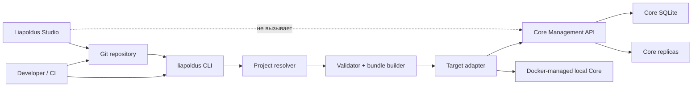

# Архитектура и границы

## 1. Компоненты



### Studio

Studio владеет проектом на рабочей машине, file tree, structured editing и
полноценной Git-интеграцией: remotes, branches, commit, push, pull, merge,
rebase, cherry-pick, stash и conflict resolution. Studio не имеет Core
connection, Core credentials или Core API adapter.

### CLI

CLI владеет операционным workflow вокруг Core:

- выбор immutable revision;
- проверка и нормализация project source;
- target resolution;
- plan/diff;
- отправка bundle;
- polling operation и безопасный exit code;
- локальный Docker lifecycle Core и уже собранных plugin binaries.

CLI не является вторым редактором проекта. Он не изменяет source files и не
выполняет Git commit за пользователя.

В коде CLI границы выражены четырьмя слоями:

```text
internal/domain          модели bundle/target и порты
internal/application     build, plan, apply и policy use cases
internal/infrastructure  Git, Core API, target registry, credentials и local Core adapter
internal/presentation    command parsing, exit codes и stdout/stderr
cmd/liapoldus             composition root
```

Presentation не вызывает Git, HTTP или process APIs напрямую. Application
зависит только от domain ports. Infrastructure не содержит deployment policy;
она предоставляет адаптеры, которые собираются в `cmd/liapoldus`.

Credential references разрешаются отдельным `CredentialProvider`; desktop
composition root использует fail-closed OS credential vault adapter. Токены
target-scoped и не хранятся в target JSON, bundle, logs или reports. Команда
`credential set` принимает значение только через скрытый TTY prompt; Studio
получает только состояние записи. CI передаёт одноразовый токен через stdin.
Для нового local Core CLI генерирует token, сохраняет его в vault и передаёт
в Docker через одноразовый файл 0600 в приватном bind mount. Token не попадает
в Docker environment или inspect metadata; Core удаляет файл до открытия API и
сохраняет verifier.

### Core

Core владеет runtime control plane и SQLite:

- принимает versioned config bundle через Management API;
- валидирует generic envelope и service-owned schemas;
- атомарно сохраняет desired configuration;
- управляет active/previous/staging generations;
- запускает rollout к replicas и фиксирует operations, leases и readiness.

Core не содержит пользовательского CLI, Git client, Git credentials, project
resolver или deployment-provider integration.

При первом запуске local target adapter CLI запускает Core container, передаёт
ему `CORE_SQLITE_PATH` и secure bootstrap references; Core создаёт initial
settings state до открытия API. Management API публикуется только на loopback,
а Plugin SDK control endpoint остаётся внутри временной Docker network. CLI не
импортирует внутренние Core packages и не открывает SQLite; remote targets
работают только через Management API или явно установленный execution adapter.

## 2. Источники истины

| Данные | Источник истины |
| --- | --- |
| Исходные файлы и история | Git remote, если он подключён и принят источником истины; иначе local Git |
| Рабочие drafts | локальный working tree Studio |
| Нормализованный bundle | конкретный CLI run и его immutable digest |
| Применённый desired state | Core SQLite |
| Active generation и rollout | Core SQLite + Core runtime observations |
| Plugin/service binary provenance | deployment/operator layer, не CLI и не Core |
| Secrets | secure store/CI secret provider; не Git и не bundle body |

Remote Git может быть declared source of truth проекта. В этом режиме Studio и
CLI не должны считать локальную ветку deployable, пока revision не прошла
политику remote approval.

## 3. Принцип отсутствия прямого доступа Studio к Core

Studio может открыть проект offline и выполнить локальную проверку структуры.
Любая информация о Core, включая target status, replica state, operations и
apply result, появляется через отдельный запуск CLI или CI result, импортированный
как безопасный report. В текущем целевом продукте Studio не создаёт Core
connection и не вызывает Core API.

Это разделяет два цикла:

```text
Studio: edit → validate → commit → push/pull
CLI:    checkout revision → plan → approval check → apply → observe
```

## 4. Два режима CLI

### Declarative deploy mode

CLI работает с project path и revision, строит bundle и отправляет его через
Core API. Это основной режим для локального deploy и CI.

### Core lifecycle mode

CLI может запускать, останавливать, проверять и читать логи локального Core.
Для удалённого Core это разрешено только target adapter с явно объявленным
transport (`ssh`, managed agent или другой утверждённый execution provider).
Один лишь API endpoint не даёт права управлять удалённым процессом.

## 5. Удаление старой границы

После миграции в Core не остаются:

- `internal/presentation/cli`;
- `cmd/core` как пользовательский CLI entrypoint;
- CLI contracts и command tests;
- Git/deploy/project parsing code.

Core сохраняет единственный runtime composition root и Management API. CLI
собирается и релизится независимо.

## 6. Runtime control-plane boundary

Для локальной plugin отладки действует строго типизированный путь:

```text
Studio → CLI → Core Management API → Plugin SDK REST API
```

CLI запускает Core и plugin containers в одной Docker network, управляет
staging и контейнерами, но не является Plugin SDK client. Он передаёт Core
только artifact ID/version/digest,
instance/replica IDs, control/peer endpoints и runtime status. Live manifest,
config schema, identity, readiness и configuration generations получает и
применяет Core.

Каждый Project service закрепляет `artifact.id`, `artifact.version`,
`artifact.platform` и `artifact.digest` в `service.yaml`; runtime plan требует
точное совпадение с CLI-owned artifact registry. Версия не выбирается по
порядку строк или «самой новой» записи, а смена binary требует явного изменения
Project reference. Runtime command и private service endpoints также берутся
из этого manifest и валидируются до создания Docker network.

Прямые CLI-вызовы plugin `/manifest`, `/config-schema`, `/identity`, `/ready` и
`/reload` запрещены. Data plane не меняется: plugin вызывает другой plugin
напрямую через `pluginprotocol`; Core и CLI business traffic не проксируют.
