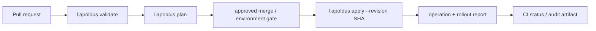

# GitHub CI и approval policy

## 1. CI использует тот же CLI

GitHub Actions не вызывает Studio и не реализует отдельный deploy script.
Pipeline устанавливает `liapoldus`, получает exact commit checkout и запускает
те же `validate`, `plan` и `apply`, что и оператор локально.



## 2. Mandatory commit gate

CI должен выполнять `apply` только с commit SHA, полученным из event/ref и
проверенным checkout. Branch name без resolved SHA недостаточен.

До apply pipeline проверяет:

- repository identity;
- commit existence и ancestry policy;
- clean checkout;
- environment approval;
- required reviewers/status checks;
- target API compatibility;
- bundle digest from plan equals digest sent to apply.

## 3. Remote source of truth

Если проект привязан к remote Git repository, remote branch/tag policy является
источником истины для deployability. Studio может создавать локальный commit,
но не может считать его production-ready до push и прохождения remote policy.

CLI не обходит branch protection, required reviews, signed commits или
environment gates. Он получает их результат от Git provider/CI и отказывается
от apply без обязательного approval evidence.

## 4. Ручной production deploy

Оператор может вручную отправить актуальную approved revision:

```bash
liapoldus plan \
  --project ./project \
  --revision 0123456789abcdef \
  --target production

liapoldus apply \
  --project ./project \
  --revision 0123456789abcdef \
  --target production \
  --confirm
```

`--confirm` подтверждает только локальный intent. Он не заменяет remote
approval и не даёт права, которых нет у credential identity.

## 5. Reports

CI публикует machine-readable report с:

- repository и commit SHA;
- project/environment/target;
- bundle digest;
- CLI version и API version;
- plan summary;
- operation ID и generation;
- replica ACK/readiness summary;
- final state и exit code.

Report не содержит secret values, tokens, private keys, raw credentials или
полный config body.
