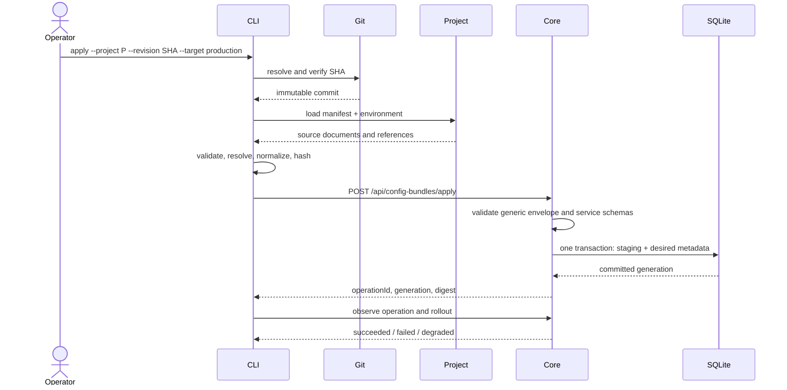

# Project и config bundle

## 1. Project source

CLI работает с тем же Project, который открывает Studio. Минимальная целевая
структура:

```text
project/
├── project.yaml                 # identity, format и target profiles
├── services/
│   └── <service-id>/
│       ├── service.yaml         # binding и schema reference
│       ├── settings.json        # один opaque declarative JSON document
│       └── links/               # Core-owned link declarations
├── modules/                     # project files для StudioPlugins
├── schemas/                     # references или project-owned schemas
├── environments/
│   ├── local.yaml
│   └── production.yaml
└── .studio/                     # local generated state, не source
```

Для Core delivery v2 service settings materialized в
`services/<service-id>/settings.json`. CLI не создаёт параллельный формат только
для CI; Studio редактирует этот же файл schema-driven формой.

Core-owned links читаются из JSON-файлов внутри
`services/<service-id>/links/` в лексикографическом порядке и передаются как
opaque object array. `.studio`, `.env*`, `*.key`, `*.pem`, `*.secret` и
`secrets/` исключаются из bundle.

## 2. Revision requirement

Команды `plan` и `apply` принимают commit SHA, tag или branch только как
удобный способ разрешить immutable revision. Перед materialization CLI обязан:

1. проверить наличие revision в локальном Git checkout;
2. получить resolved commit SHA;
3. убедиться, что working tree не содержит изменений, влияющих на bundle;
4. зафиксировать SHA в report и request;
5. отказать в `apply`, если revision нельзя однозначно воспроизвести.

`apply` никогда не читает draft из незакоммиченного working tree.

Для разработки Studio действует отдельный local-only контракт `liapoldus dev
plan|apply`. CLI делает закрытую копию безопасных project files, строит bundle
из неё и передаёт Core revision `working-tree:<bundle-digest>`. Snapshot
проверяется на параллельные изменения, symlink и path traversal, содержит
текущие удаления и untracked файлы, но исключает `.studio/` и secret paths.
Исходный Git index и checkout не меняются. Операция принимается только для
`local`; production/remote сохраняет commit-based `plan/apply`.

## 3. Materialization pipeline



## 4. Что именно попадает в SQLite

В Core API передаётся не набор файлов, а canonical config bundle:

- project identity;
- target/environment identity;
- source commit SHA и repository identity;
- bundle schema version;
- deterministic bundle digest;
- service instances и их opaque settings documents;
- Core-owned links;
- safe provenance metadata;
- references на secrets, но не значения secrets.

Core принимает bundle через API и сохраняет desired configuration и provenance
metadata собственными SQLite invariants. Для каждой service configuration сохраняются raw JSON bytes
в соответствии с Core storage invariants; Core не переписывает
product-specific fields.

После транзакции Core сам управляет `staging → active`, `previous`, generation,
operation journal и replica acknowledgements. CLI не открывает Core SQLite и не
пишет desired state напрямую; local lifecycle/backup/restore доступны только
отдельному target execution adapter.

## 5. Determinism

Одинаковые project files, environment inputs и commit должны давать одинаковые
canonical bundle bytes и digest. В bundle builder запрещены:

- текущие timestamps как значения конфигурации;
- порядок файлов файловой системы;
- machine-local absolute paths;
- случайные identifiers;
- чтение незаявленных ENV variables;
- включение secret values.

В report должны быть видны input revision, target, environment, schema versions
и digest, чтобы plan можно было повторить в CI.

## 6. Secrets и внешние inputs

Project хранит только symbolic secret references. CLI получает значения из
локального secure provider или CI secret store, если это требуется Core API
протоколом, и передаёт их только по защищённому transport либо выполняет
server-side redemption. Значения не попадают в bundle digest display, logs,
Git, Core settings JSON или operation report.

## 7. Reproducibility и rollback

Rollback — это повторный `apply` уже известной Git revision либо специальная
Core rollback operation, если она разрешена API contract. CLI не делает rollback
по файловому snapshot и не извлекает конфигурацию из SQLite обратно в Git.

## 8. Переход на Services

В текущем CLI Project уже использует `services/<id>/service.yaml`, а локальный
реестр `artifacts.json` — нейтральные поля `id`, `version`, `platform`, `digest`,
`path`, `trusted`. Для таких данных переход не требует записи или изменения
формата: команды `service artifact list|inspect|trust` используют прежний реестр,
сохраняя регистрации, доверие, digest, binary paths и optional launch arguments.
Отдельная автоматическая миграция manifest и recovery journal не нужны.

Старые runtime paths `plugins/<id>/{plugin.yaml,service.yaml,settings.json,links/}`
и `services/<id>/plugin.yaml` отклоняются до delivery с указанием первого пути
в лексикографическом порядке. CLI не пропускает их молча и не выбирает artifact
по одному ID. Если внешний Project ещё использует эти пути, оператор переносит
исходники в каноническую структуру отдельным Git-изменением, сохраняя IDs и точные
байты settings/links. Manifest должен явно закреплять artifact version/platform/
digest и runtime endpoints. Нельзя получать эти значения догадкой из старого
manifest.

Preview — Git diff и `liapoldus runtime plan --project <path> --revision <commit>
--target <target>` после фиксации Project revision; `liapoldus plan` дополнительно
проверяет конфигурацию через Core. До запуска recovery сводится к выбору исходной
Git revision; после apply используется Core rollback согласно его контракту.
Исторические reports, сохранённые generations и их digests не переписываются.
Service SDK и Wool сертификаты выпускаются заново с URI
`spiffe://liapoldus/service/{instanceId}/{replicaId}/{incarnationId}`; старые URI
не принимаются как runtime identity.
