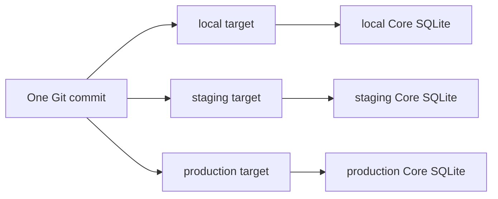

# Targets и несколько Core

## 1. Target model

Target — именованный deployment context проекта. Он связывает environment,
Core endpoint, transport capabilities, API compatibility и credential refs.

```yaml
targets:
  - name: local
    environment: local
    transport: local-process
    trafficReportPath: reports/traffic.json
    endpoint: https://127.0.0.1:8080
  - name: production
    environment: production
    transport: remote-api
    endpoint: https://core.example
    # Token is supplied ephemerally via --token-stdin in CI.
    approval: remote-required
```

В текущем CLI target registry хранится как JSON в пути
`LIAPOLDUS_TARGETS_FILE` (по умолчанию OS config directory
`liapoldus/targets.json`). Секреты, private keys и access tokens в registry не
хранятся. `credentialRef` — стабильный target-scoped указатель на системный
credential vault; значение ключа недоступно из target profile.

Пример local target:

```json
{
  "targets": [{
    "name": "local",
    "environment": "local",
    "transport": "local-process",
    "endpoint": "https://127.0.0.1:8080",
    "credentialRef": "os-keyring:v1:core-management:<target-hash>",
    "caFile": ".studio/tls/ca.pem",
    "clientCertFile": ".studio/tls/cli.crt",
    "clientKeyFile": ".studio/tls/cli.key",
    "serverName": "localhost",
    "coreBinary": "/usr/local/bin/core",
    "statePath": ".studio/local/core.sqlite",
    "pidPath": ".studio/local/core.pid",
    "logPath": ".studio/local/core.log",
    "bootstrap": {
      "managementCertificate": ".studio/tls/management.crt",
      "managementKey": ".studio/tls/management.key",
      "managementClientCA": ".studio/tls/ca.pem",
      "controlCertificate": ".studio/tls/control.crt",
      "controlKey": ".studio/tls/control.key",
      "replicaClientCA": ".studio/tls/replica-client-ca.pem",
      "replicaServerCA": ".studio/tls/replica-server-ca.pem",
      "secretRoot": ".studio/secrets"
    }
  }]
}
```

`local-process` — существующее имя transport для локального target profile; в
текущем runtime Core и plugins всегда запускаются в Docker, host-process
fallback отсутствует. `core start/stop/status/logs` управляют контейнером;
remote API target не получает runtime/process access.

`trafficReportPath` — необязательный project-relative путь к report, который
создаёт CLI/Core observation pipeline. Он не может быть absolute или выходить
за пределы Project. Studio получает только report event, повторно применяет
redaction и сохраняет безопасную копию в `.studio/reports`.

## 2. Multiple Core workflow

Один Project может применяться к нескольким Core, но каждый `apply` явно
получает target. CLI не считает production продолжением local и не переносит
локальный SQLite.



Для каждого target отдельно фиксируются bundle digest, operation, generation,
replica observations и audit context.

## 3. Local Core

Local target может включать:

- бинарь Core;
- managed data directory;
- SQLite path;
- Docker image/platform и постоянный state path;
- local certificates и credential reference на системный secure store;
- port and health endpoint.

Первый запуск local Core выполняется в Docker через `liapoldus core start` или
`runtime start`. CLI создаёт случайный management token, сохраняет его в
системном vault и монтирует одноразовый файл `0600`; token не передаётся в Docker
environment. Core удаляет файл после чтения и сохраняет только verifier.
Повторный запуск не ротирует credential. Секретные значения не попадают в
project files, Git, target profile, bundle, container metadata или logs.

Проверить наличие записи можно командой `liapoldus credential status --target
local`; настроить вручную — `liapoldus credential set --target local` со
скрытым интерактивным вводом. Удаление требует `--confirm`. При существующей
Core state без доступной credential CLI не пересоздаёт базу и не выполняет
тихую ротацию: оператор должен восстановить исходный token либо выбрать новый
state path.

Для нового локального Core target обязан указать Linux Core binary, Docker runtime
image, платформу, state path, Management endpoint и абсолютные после разрешения
registry пути к management/control certificate и key, replica client/server CA и
`secretRoot`. Относительные пути из profile разрешаются относительно файла
registry. TLS references передаются Core как `CORE_INIT_*` environment values;
секретный token передаётся только файлом. После bootstrap Core хранит settings
в SQLite. Management API слушает container network, но Docker публикует его
только на host loopback; Plugin SDK REST/control endpoints не публикуются.

Для каждого runtime plugin в `runtime.tlsDirectory` CLI ожидает пары
`<plugin>.crt`/`<plugin>.key` для SDK↔Core и `<plugin>-peer.crt`/
`<plugin>-peer.key` для `pluginprotocol`. Peer certificate может иметь отдельный
ключ, но его единственный URI SAN обязан совпадать с полным replica URI из
Core-сертификата: `spiffe://liapoldus/plugin/<instance>/<replica>/<incarnation>`.
Этот же URI передаётся plugin SDK как peer identity, а Core peer directory
использует его для точного pin при вызове. Общий URI вида
`spiffe://liapoldus/plugin/<plugin>` не подходит: mTLS handshake завершится
ошибкой проверки identity, даже если обе стороны доверяют одной CA. CLI
проверяет это до создания контейнера и отказывает без ослабления pinning.

`core start`, `core stop`, `core restart`, `core status` и `core logs` управляют
Docker runtime. Database backup/restore допускается только при остановленном
Core container и копирует SQLite-файл как opaque state; CLI не открывает SQLite
и не использует непубличные Core packages.

## Локальные порты plugin runtime

У выбранного `runtime.publicServiceId` CLI разделяет product HTTP listener и
SDK-backed public API (`/healthz`, `/metrics`, диагностический peer endpoint):
`runtime.publicPort` публикует `runtime.publicContainerPort` для product routes,
а `runtime.publicApiHostPort` публикует `runtime.publicApiContainerPort` для
SDK-backed поверхности. Обе host-привязки ограничены `127.0.0.1`. Если API-порты
не заданы, CLI выбирает следующий номер после соответствующего product port
(например, `19080:9080` и `19081:9081`) и отклоняет совпадающие порты.

Это позволяет Server/Caddy слушать `:9080`, не конфликтуя с отдельным SDK
HTTP listener на `:9081`; обычный запрос к настроенному Server route идёт на
product host port, а `/healthz` и `/metrics` доступны на API host port.

## 4. Remote Core

Remote target может поддерживать только API operations либо также lifecycle
operations через `ssh`, managed agent или другой зарегистрированный provider.
Эти возможности объявляются capability discovery и явно показываются в plan.

Для удалённого HTTPS Core target registry может содержать `caFile`,
`clientCertFile`, `clientKeyFile` и `serverName`. Пути разрешаются относительно
registry-файла; private key и certificate contents не попадают в registry или
bundle. CLI использует TLS 1.2 или новее и проверяет client certificate/key как
пару.

Удалённый API-only target разрешает `status`, `plan`, `apply` и observation, но
не обещает `start`/`stop`. Это предотвращает ложное ощущение, что Management API
владеет удалённым process supervisor.

`approval: remote-required` включает обязательную проверку approval evidence в
`apply`. Evidence должна ссылаться на тот же Git repository, exact commit и
target; локальный `--confirm` не является обходом этого правила.

## 5. Target isolation

- target selection обязательна для `plan` и `apply`;
- credentials одного target не доступны другому;
- operation polling не смешивает Core instances;
- bundle digest одинаков для одинакового environment input, но target metadata
  и operation IDs различаются;
- CLI никогда не копирует SQLite между targets.
