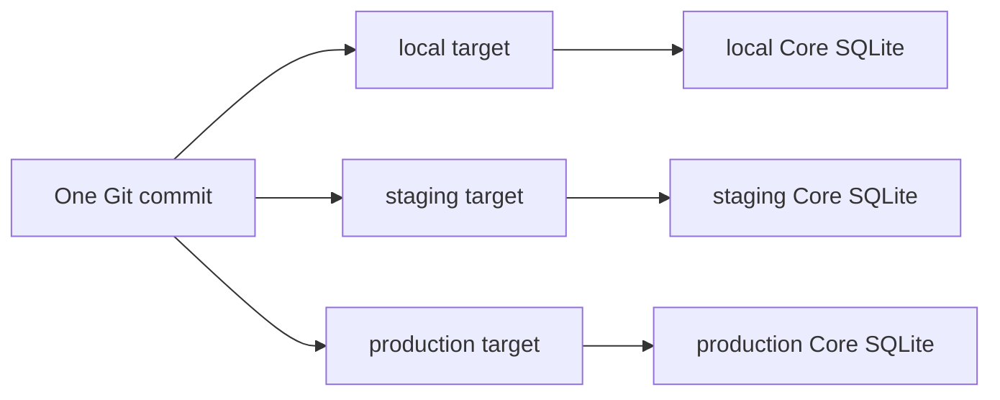

# Targets и несколько Core

## 1. Target model

Target — именованный deployment context проекта. Он связывает environment,
Core endpoint, transport capabilities, API compatibility и credential refs.

```yaml
targets:
  - name: local
    environment: local
    transport: local-process
    endpoint: https://127.0.0.1:8080
  - name: production
    environment: production
    transport: remote-api
    endpoint: https://core.example
    tokenEnv: CORE_TOKEN
    approval: remote-required
```

В текущем CLI target registry хранится как JSON в пути
`LIAPOLDUS_TARGETS_FILE` (по умолчанию OS config directory
`liapoldus/targets.json`). Секреты, private keys и access tokens в registry не
хранятся; `core status` использует health endpoint, а token применяется только
при bundle operations.

Пример local target:

```json
{
  "targets": [{
    "name": "local",
    "environment": "local",
    "transport": "local-process",
    "endpoint": "https://127.0.0.1:8080",
    "caFile": ".studio/tls/ca.pem",
    "clientCertFile": ".studio/tls/cli.crt",
    "clientKeyFile": ".studio/tls/cli.key",
    "serverName": "localhost",
    "coreBinary": "/usr/local/bin/core",
    "statePath": ".studio/local/core.sqlite",
    "pidPath": ".studio/local/core.pid",
    "logPath": ".studio/local/core.log",
    "bootstrap": {
      "managementCertificate": ".studio/tls/management.crt",
      "managementKey": ".studio/tls/management.key",
      "managementClientCA": ".studio/tls/ca.pem",
      "controlCertificate": ".studio/tls/control.crt",
      "controlKey": ".studio/tls/control.key",
      "replicaClientCA": ".studio/tls/replica-client-ca.pem",
      "replicaServerCA": ".studio/tls/replica-server-ca.pem",
      "secretRoot": ".studio/secrets"
    }
  }]
}
```

`liapoldus core start/stop/status/logs` работают только с объявленным
`local-process`; remote API target не получает процессный доступ.

## 2. Multiple Core workflow

Один Project может применяться к нескольким Core, но каждый `apply` явно
получает target. CLI не считает production продолжением local и не переносит
локальный SQLite.



Для каждого target отдельно фиксируются bundle digest, operation, generation,
replica observations и audit context.

## 3. Local Core

Local target может включать:

- бинарь Core;
- managed data directory;
- SQLite path;
- process state;
- local certificates/credentials через secure store;
- port and health endpoint.

Первый запуск local Core выполняется через `liapoldus core start`: target
adapter передаёт Core `CORE_SQLITE_PATH` и secure bootstrap references, а Core
создаёт initial settings state. Секретные значения не попадают в project files,
Git, bundle или logs.

Для нового локального Core target обязан указать абсолютные после разрешения
registry пути к management/control certificate и key, replica client/server CA и
`secretRoot`. Относительные пути из profile разрешаются относительно файла
registry. Эти значения становятся только `CORE_INIT_*` environment references;
после bootstrap Core хранит settings в своей SQLite и читает их сам.

`core start`, `core stop`, `core restart`, `core status` и `core logs` действуют
через target adapter. `core database backup/restore` использует поддержанный
Core API или execution adapter. CLI не изменяет SQLite напрямую и не использует
непубличные Core packages.

## 4. Remote Core

Remote target может поддерживать только API operations либо также lifecycle
operations через `ssh`, managed agent или другой зарегистрированный provider.
Эти возможности объявляются capability discovery и явно показываются в plan.

Для удалённого HTTPS Core target registry может содержать `caFile`,
`clientCertFile`, `clientKeyFile` и `serverName`. Пути разрешаются относительно
registry-файла; private key и certificate contents не попадают в registry или
bundle. CLI использует TLS 1.2 или новее и проверяет client certificate/key как
пару.

Удалённый API-only target разрешает `status`, `plan`, `apply` и observation, но
не обещает `start`/`stop`. Это предотвращает ложное ощущение, что Management API
владеет удалённым process supervisor.

`approval: remote-required` включает обязательную проверку approval evidence в
`apply`. Evidence должна ссылаться на тот же Git repository, exact commit и
target; локальный `--confirm` не является обходом этого правила.

## 5. Target isolation

- target selection обязательна для `plan` и `apply`;
- credentials одного target не доступны другому;
- operation polling не смешивает Core instances;
- bundle digest одинаков для одинакового environment input, но target metadata
  и operation IDs различаются;
- CLI никогда не копирует SQLite между targets.
